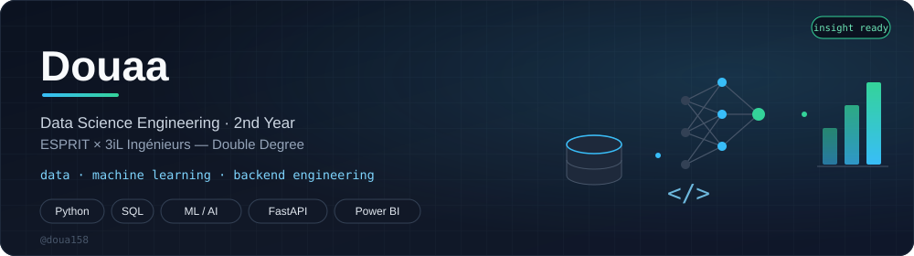

 

## Profile

Data Science & AI engineering student in the **ESPRIT × 3iL Ingénieurs double-degree program** (Tunisia / France), graduating in June 2028. I design and ship AI systems end to end: dataset design, embedding model selection, retrieval, LLM agents and production-ready FastAPI backends.

**Seeking an apprenticeship (alternance) in AI / Data Science starting September 2027.**

**Focus areas:** retrieval-augmented generation · multi-agent LLM systems · semantic search · applied machine learning
**Currently learning:** Business Intelligence & Big Data

## Tech stack

| Area | Tools |
|---|---|
| Deep learning | PyTorch, Hugging Face Transformers, LoRA / PEFT, Computer Vision, Reinforcement Learning (PPO) |
| LLMs & agents | LangGraph, LangChain, n8n, RAG, prompt engineering |
| Retrieval | BAAI/bge-m3, pgvector (HNSW), Qdrant |
| Backend & data | FastAPI, PostgreSQL, Docker, scikit-learn, XGBoost, Power BI |

## Selected projects

| Project | Description | Stack |
|---|---|---|
| [**DREZIGN Connect**](https://github.com/doua158/drezign-connect-showcase) | Multimodal B2B textile search engine; full AI backend built from scratch as Lead AI/Backend at FabricGard Consulting. Text, image and voice search over a 12,050-article synthetic dataset, with progressive fallback scoring. bge-m3 chosen over all-MiniLM after retrieval-quality testing. | FastAPI, PostgreSQL, pgvector, HNSW |
| [**CampusFlow AI**](https://github.com/doua158/CampusFlow_AI) | Multimodal Telegram assistant for ESPRIT students (team project). RAG over school regulations with citations: Hit@5 improved from 0.86 to 1.00 with article-level chunking. My contribution: RAG strategy, end-to-end test harness and evaluation. | n8n, Qdrant, Ollama, Docker |
| [**CallVerse**](https://github.com/doua158/CallVerse) | Digital twin of a telecom call center for testing staffing and support strategies without risking real customers (team project). Multi-agent service: Customer Advisor and Client Simulator (LangGraph), Workforce Manager (RL), Quality Analyst (LLM-as-judge). | LangGraph, FastAPI, pgvector, Spring Boot |
| [**ArchiGuide**](https://github.com/doua158/ArchiGuide) | Architectural style recognition: ResNet-101 + EfficientNetV2 ensemble and a Phi-3 Mini model fine-tuned with LoRA. | PyTorch, LoRA, Phi-3 |
| **QoS Buddy** | Multi-agent telecom QoS supervision (RAG + RandomForest, R² = 0.941), deployed on HuggingFace Spaces and Vercel. Built for a company: private repository, code confidential. | RAG, RandomForest, multi-agent |
| **DREZIGN Studio** | AI-powered fashion brief generation: versioned BriefSchema and Master Prompt specs, cross-field validation for structured generation. Client project: code confidential. | Python, prompt engineering |

## Experience and education

- **Lead AI/Backend, FabricGard Consulting** (2026): retrieval pipeline and API for a multimodal B2B search platform
- **Machine Learning Intern, STB** (summer 2025): customer churn prediction with XGBoost, AUC-ROC above 0.85
- **ESPRIT × 3iL Ingénieurs**, double-degree engineering program, Data Science & AI (2024 – June 2028)
- **Certifications:** NVIDIA Deep Learning and MLOps (Coursera)

## Contact

[LinkedIn](https://www.linkedin.com/in/doua-omrani-925931369) · [omrani.doua@gmail.com](mailto:omrani.doua@gmail.com) · Limoges, France
