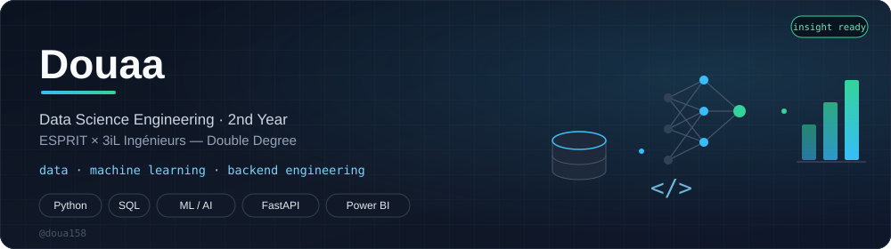

<div align="center">



<br/>

[](https://git.io/typing-svg)

<p>
<a href="https://www.linkedin.com/in/YOUR-LINKEDIN"></a>
<a href="mailto:doua158@gmail.com"></a>


</p>

</div>

---

### About me

I'm a **Data Science Engineering student**, 2nd year of the engineering cycle, in a **double-degree program between ESPRIT (Tunisia) and 3iL Ingénieurs (Limoges, France)**, graduating in June 2028.

I build AI systems end-to-end — from synthetic dataset design and embedding model selection to production-ready FastAPI backends. I recently worked as **Lead AI/Backend at FabricGard Consulting**, building the retrieval pipeline for a multimodal B2B search platform from scratch.

```python
class Douaa:
    def __init__(self):
        self.focus = ["RAG", "semantic search", "applied ML"]
        self.currently_learning = "Business Intelligence & Big Data"
        self.open_to = "AI Engineering / Data Science internships"

    def debug(self, bug):
        return "fixed it, wrote a LinkedIn post about it" if bug else None
```

---

### Tech stack

<p>

</p>

`BAAI/bge-m3` · `pgvector` · `HNSW indexing` · `LangChain` · `XGBoost` · `Power BI` · `Prompt Engineering`

---

### Flagship projects

<table>
<tr>
<td width="50%" valign="top">

**[DREZIGN Connect](https://github.com/doua158/drezign-connect-showcase)**
Multimodal B2B textile search engine — full AI backend built from scratch.

- 12,050-article synthetic dataset across 5 fabric families
- Text / image / voice search with progressive fallback scoring
- bge-m3 selected over all-MiniLM after retrieval-quality testing

`FastAPI` `PostgreSQL+pgvector` `HNSW`

</td>
<td width="50%" valign="top">

**DREZIGN Studio** <sub>(client project — code confidential)</sub>
AI-powered fashion brief generation platform.

- Versioned BriefSchema & Master Prompt specs (v2.2 → v2.3)
- Cross-field validation logic for structured generation

`Python` `Prompt Engineering` `Schema Design`

</td>
</tr>
<tr>
<td width="50%" valign="top">

**QoS Buddy** <sub>(private / no public repo yet)</sub>
Multi-agent telecom QoS supervision system.

- RAG + RandomForest, **R² = 0.941**
- Deployed on HuggingFace Spaces & Vercel

`RAG` `RandomForest` `Multi-agent`

</td>
<td width="50%" valign="top">
<tr>
<td width="50%" valign="top">

**[CallVerse](https://github.com/doua158/CallVerse)** <sub>(team project)</sub>
Digital twin of a telecom call center, used to test staffing and support strategies without risking real customers.

- Multi-agent AI service: Customer Advisor and Client Simulator (LangGraph), Workforce Manager (RL, PPO), Quality Analyst (LLM-as-judge)
- Tool-calling agent with RAG over a pgvector knowledge base
- Single FastAPI service integrated with a Spring Boot backend and a Next.js frontend

`LangGraph` `FastAPI` `pgvector` `Reinforcement Learning` `Spring Boot`

</td>
<td width="50%" valign="top">

</td>
</tr>
**[ArchiGuide](https://github.com/doua158/ArchiGuide)**
Architectural style recognition system.

- ResNet-101 + EfficientNetV2 ensemble
- Phi-3 Mini fine-tuned with LoRA

`Computer Vision` `LoRA` `Phi-3`

</td>
</tr>
</table>

---

### Other repositories

| Project | Stack |
|---|---|
| [employee-retention-prediction](https://github.com/doua158/employee-retention-prediction) | Python |
| [breast-cancer-detection](https://github.com/doua158/breast-cancer-detection) | HTML |
| [smart-carpooling-javafx](https://github.com/doua158/smart-carpooling-javafx) | Java |

---

### GitHub stats

<p align="center">


</p>

<p align="center">

</p>

---

### Background

- 🧪 ML Internship at **STB** (Summer 2025) — churn prediction, XGBoost, AUC-ROC > 0.85
- 🏅 NVIDIA Deep Learning & MLOps certifications (Coursera)
- 🇹🇳 From Gafsa, Tunisia — now based in Limoges, France

<div align="center">
<sub>Building things that retrieve the right answer, not just an answer.</sub>
</div>
